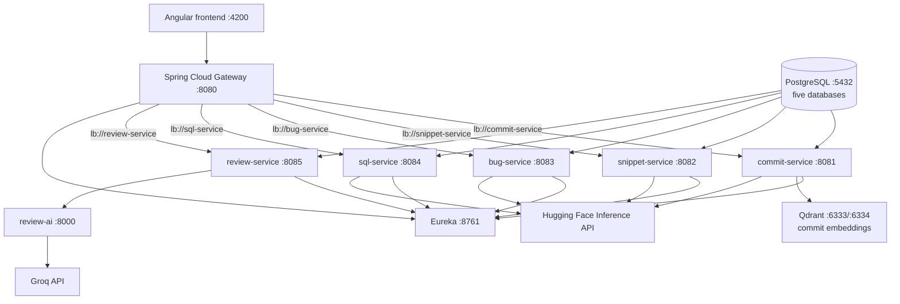

# DevAssist Hub

## Project overview

DevAssist Hub is a full-stack university project with five independent modules.
Each module is designed as a CRUD feature plus one LLM-powered feature. The
commit, SQL, and code-review services are implemented; the snippet and bug
services remain scaffolds.

## Architecture



| Service | Port | Responsibility |
|---|---:|---|
| `frontend` | 4200 | Angular application |
| `api-gateway` | 8080 | CORS, entry point, and load-balanced routing |
| `eureka-server` | 8761 | Service discovery |
| `commit-service` | 8081 | Commits and commit embeddings |
| `snippet-service` | 8082 | Code snippets |
| `bug-service` | 8083 | Bug reports |
| `sql-service` | 8084 | SQL queries |
| `review-service` | 8085 | Code reviews |
| `review-ai` | internal | RAG-assisted code review with Groq |
| `postgres` | 5432 | Five service-owned relational databases |
| `qdrant` | 6333/6334 | Vector storage (REST/gRPC) |

**Tech stack:** Spring Boot 3.3.5, Java 21, Maven, Angular, PostgreSQL,
Qdrant, Eureka, Spring Cloud Gateway, Hugging Face Inference API, and Groq.

PostgreSQL contains `commit_db`, `snippet_db`, `bug_db`, `sql_db`, and
`review_db`. Qdrant stores the planned `commit_embeddings` collection for
commit-service. The snippet and bug modules still contain placeholders.

## Module ownership

| Module | Service | Port | Owner | LLM feature |
|---|---|---:|---|---|
| Commits | `commit-service` | 8081 | Farouk | Diff → commit message, with RAG over past commits |
| Code snippets | `snippet-service` | 8082 | TBD | Snippet → docstring and tags |
| Bug reports | `bug-service` | 8083 | TBD | Report → severity, category, and suggested title (JSON) |
| SQL queries | `sql-service` | 8084 | TBD | Natural language → read-only validated SQL |
| Code reviews | `review-service` | 8085 | TBD | Code → smells and vulnerabilities with explanations |

## SQL validation safety

`sql-service` exposes `POST /api/sql/validate`, which parses SQL (it never
executes it) and reports whether it is a single read-only SELECT. Every result
carries this Safety Note:

> This check verifies only that the SQL is a single read-only SELECT structure.
> It does not verify that the SQL is correct, fast, or safe on your schema.
> Run generated SQL as a read-only database user.

The validator is a guard rail, not a security boundary. Always run generated or
saved SQL as a database user that has only `SELECT` privileges (for example
`GRANT SELECT ON ALL TABLES IN SCHEMA public TO readonly_user;` with no write,
DDL, or superuser rights), and set a `statement_timeout` for that user.

## Getting started

### Prerequisites

- Docker Desktop
- Git

### Full stack

```bash
copy .env.example .env
```

Add the Hugging Face token and `GROQ_API_KEY` to `.env`, then run:

```bash
docker compose up --build
```

URLs:

- Frontend: http://localhost:4200
- Gateway: http://localhost:8080
- Eureka: http://localhost:8761
- Qdrant REST: http://localhost:6333

To work only on your service while using shared infrastructure:

```bash
docker compose up --build eureka-server postgres api-gateway <your-service>
```

Replace `<your-service>` with `commit-service`, `snippet-service`,
`bug-service`, `sql-service`, or `review-service`.

## Team workflow

- Use branches named `feature/<service>-<topic>`.
- Open pull requests into `develop`.
- Merge `develop` into `main` only at agreed milestones.
- Use Conventional Commits.
- Prefer small, frequent commits.
- Edit only your service folder and your Angular feature module.
- Change shared files such as `docker-compose.yml`, gateway routes, and
  PostgreSQL init scripts only through a reviewed pull request.

## Troubleshooting

- **Slow Docker pulls:** wait for the pull to finish and retry after confirming
  Docker Desktop has network access. Do not replace pinned project images without
  team approval.
- **Service missing from Eureka:** check the service logs, its
  `EUREKA_CLIENT_SERVICEURL_DEFAULTZONE`, and that `eureka-server` is healthy.
- **Gateway returns 503:** confirm the target service is healthy and registered
  in Eureka; check the `lb://` route name matches `spring.application.name`.
- **Missing HF token:** set `HF_API_TOKEN` in `.env`, then recreate the affected
  service container.

See [`docs/PROJECT_CONTEXT.md`](docs/PROJECT_CONTEXT.md) for the detailed team
brief, conventions, and definition of done.
